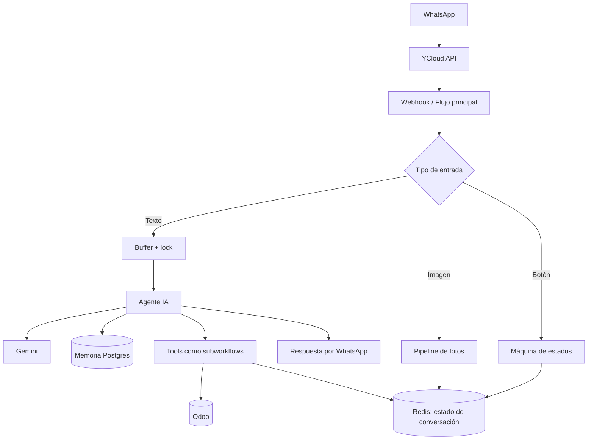
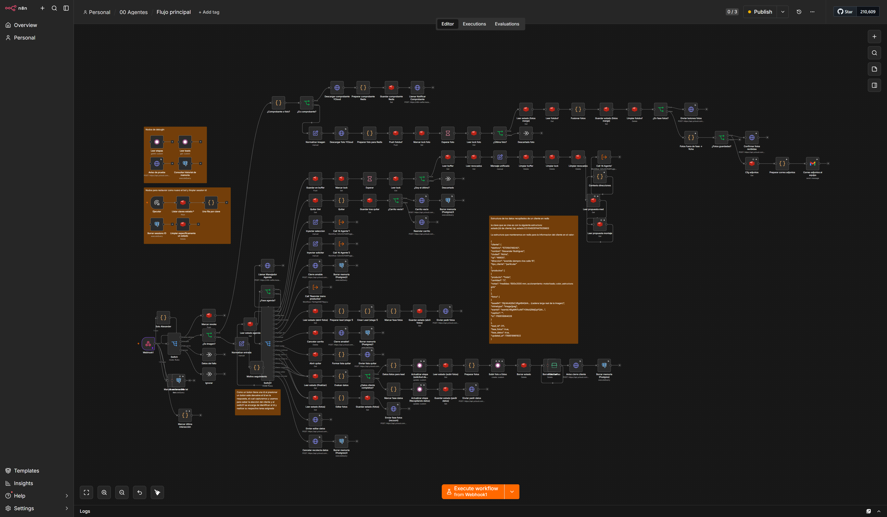
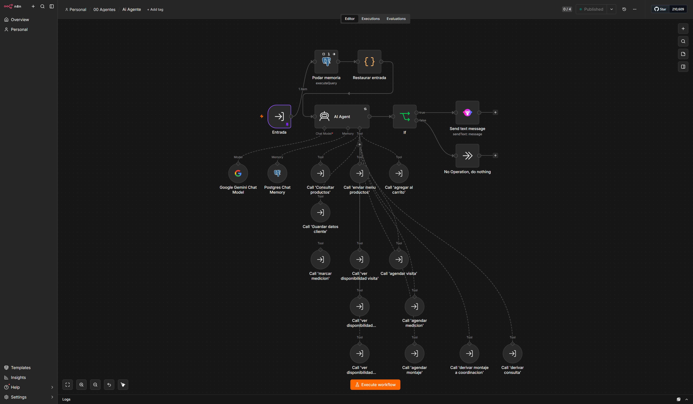
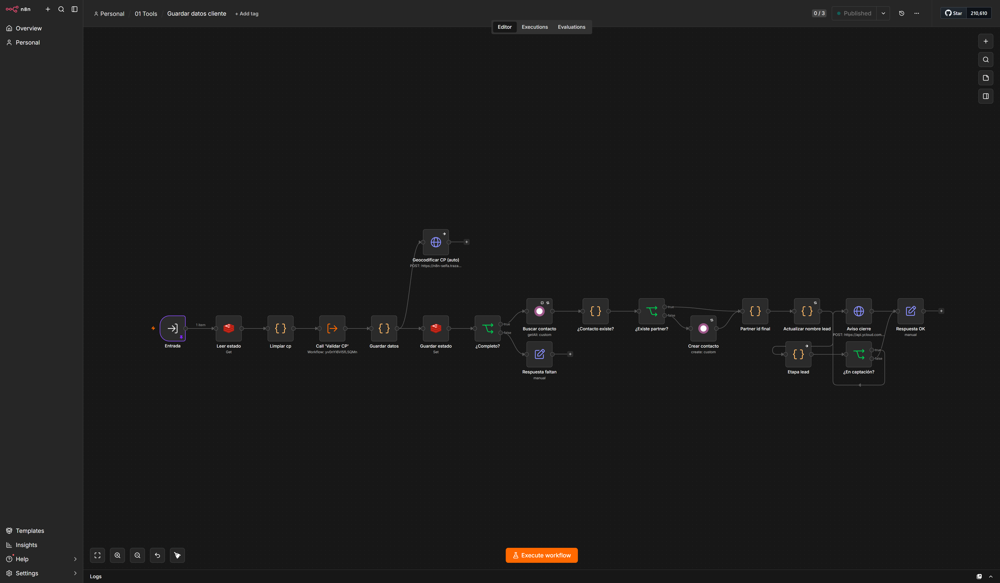

# Sistema de atención y captación de leads por WhatsApp con n8n e IA

Automatización en producción que atiende conversaciones de WhatsApp con un agente
de IA, recopila los datos del cliente en varias etapas, gestiona fotos y
agendamientos, y registra todo en Odoo sin intervención manual.

> Diseñé y construí estos flujos. Posteriormente el equipo del cliente añadió
> herramientas adicionales al agente.
>
> Workflows anonimizados: credenciales, endpoints, teléfonos y datos de cliente
> fueron reemplazados por valores de ejemplo.

---

## El problema

[SECTOR DEL CLIENTE] atendía por WhatsApp consultas de producto, solicitudes de
cotización y agendamiento de visitas de forma manual. Cada conversación exigía
que una persona respondiera, pidiera los datos uno por uno, recibiera fotos
sueltas y luego registrara el lead a mano en Odoo.

El canal funcionaba, pero no escalaba: los tiempos de respuesta dependían de la
disponibilidad del equipo y los datos llegaban incompletos o se perdían entre
conversaciones.

---

## La solución



El sistema se organiza en tres capas, que corresponden a las carpetas del
repositorio:

| Capa | Qué hace |
|---|---|
| `00 Agentes` | Interpretan la intención del usuario y deciden qué herramienta invocar |
| `01 Tools` | Ejecutan acciones concretas: consultar, validar, escribir en Odoo |
| `02 Reglas` | Disparadores y reglas de negocio automatizadas |

Cada herramienta del agente es un workflow independiente, no un bloque dentro de
un monolito. Eso permite modificar una capacidad sin tocar el resto del sistema,
y fue lo que después le permitió al equipo del cliente añadir herramientas
nuevas sin reescribir nada.

---

## Workflows incluidos

### 1. Flujo principal — orquestación



Recibe el webhook de YCloud y enruta según el tipo de entrada: texto, imagen,
comprobante de pago o pulsación de botón. Gestiona el estado de cada
conversación en Redis, el ciclo de recolección de datos por fases y el envío de
los leads a Odoo.

### 2. Ai Agente — capa de decisión



Agente construido sobre Gemini con memoria persistente en Postgres. Cada
capacidad (consultar productos, agregar al carrito, agendar visita, agendar
medición, derivar a coordinación) está implementada como un subworkflow
invocado como tool.

### 3. Guardar datos cliente — integración con Odoo



Recibe los datos recopilados, los valida y normaliza, geocodifica la dirección
a partir del código postal y los escribe en Odoo resolviendo primero si el
contacto ya existe.

---

## Decisiones técnicas

### Buffer con lock para agrupar mensajes

En WhatsApp la gente no escribe un mensaje: escribe tres seguidos. Sin control,
cada uno dispara una ejecución y el agente responde tres veces a una sola idea.

La solución acumula los mensajes entrantes en un buffer en Redis, marca un lock,
espera una ventana corta y verifica si la ejecución actual corresponde al último
mensaje recibido. Solo esa continúa; las anteriores se descartan. El agente
recibe el mensaje unificado y responde una vez.

> [CONFIRMAR: si el lock resuelve algo distinto a esto, corregir el párrafo.]

### Poda de memoria conversacional

La memoria del agente vive en Postgres y se poda [POR NÚMERO DE MENSAJES /
POR ANTIGÜEDAD / POR TAMAÑO DE CONTEXTO — completar] antes de cada invocación.

Sin esto el contexto crece sin límite en conversaciones largas: sube el costo
por token en cada turno y el modelo empieza a arrastrar información irrelevante.
Podar mantiene la continuidad de la conversación acotando lo que se envía.

### Escritura idempotente en Odoo

Antes de crear un contacto, el flujo lo busca, comprueba si existe, resuelve el
`partner id` y solo crea el registro cuando no hay coincidencia. Después
actualiza el lead y su etapa.

Esto evita duplicados cuando una conversación se reanuda o cuando un reintento
vuelve a ejecutar el mismo tramo, que es el modo habitual de ensuciar un CRM
desde una automatización.

### Recolección de fotos por fases

El cliente envía varias fotos sueltas, no un lote. El flujo las acumula en un
buffer, las fusiona en un conjunto por fase y confirma la recepción antes de
continuar, en lugar de procesar cada imagen por separado.

> [CONFIRMAR: ajustar si las fases corresponden a momentos distintos del proceso
> y no a un solo lote.]

### Estado de conversación en Redis

Cada conversación mantiene su estado bajo una clave por cliente, con los datos
recopilados, las fotos recibidas y la fase actual. Permite que la conversación
sobreviva entre ejecuciones y que cualquier flujo sepa en qué punto está el
cliente sin reconstruirlo desde el historial.

---

## Stack

n8n self-hosted (Docker, VPS) · Google Gemini · YCloud (WhatsApp Business API) ·
Odoo (API REST) · PostgreSQL · Redis

---

## Estructura del repositorio

```
.
├── workflows/
│   ├── flujo-principal.json
│   ├── ai-agente.json
│   └── guardar-datos-cliente.json
└── docs/
    ├── flujo-principal.png
    ├── agente.png
    ├── guardar-datos-cliente.png
    └── ejecuciones.png
```

Los tres workflows incluidos son representativos de un sistema más amplio en
producción.

---

**José Carlos Ibarra Herrera** · [GitHub](https://github.com/JoseIbarraH) ·
[LinkedIn](https://www.linkedin.com/in/jos%C3%A9-carlos-ibarra-herrera-107b0617b/)
